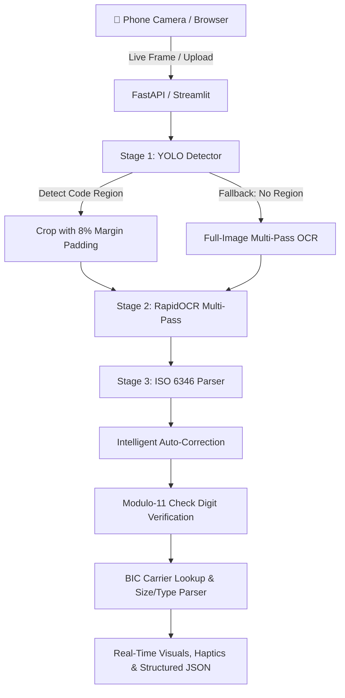

# 🚢 ContainerLens: Automated Shipping Container Number Identification System

**ContainerLens** is an end-to-end Computer Vision and OCR system engineered to detect, extract, parse, and mathematically validate international shipping container numbers (**ISO 6346**) from real-world photos, port gate cameras, and logistics imagery.

---

## 🌟 Highlights

- **Custom-Trained YOLO Detector**: Fine-tuned on the Roboflow `container-t4xvw-suyj8` dataset (6,289 images) to localize container code panels (`con-region`), filtering out ground noise, truck numbers, license plates, and yard signs.
- **Multi-Pass OCR Engine**: RapidOCR (ONNX Runtime) with adaptive CLAHE contrast enhancement and resolution upscaling to handle corrugated steel panels, rust, scratches, and shadows.
- **ISO 6346 Mathematical Validator**: Real-time verification of the Modulo-11 check digit algorithm.
- **Intelligent Error Correction**: Auto-repairs single-character OCR confusions (e.g., `0` vs `O` vs `U`, `B` vs `8`, `I` vs `1`) by testing substitutions against the ISO check digit formula and known BIC owner codes.
- **BIC Shipping Line Database**: Identifies carrier names (Triton, Maersk, MSC, CMA CGM, Evergreen, COSCO, ONE, Hapag-Lloyd, etc.).
- **ISO Size/Type Code Parser**: Identifies container length, height, and type (e.g., `45G1` = 40ft High Cube General Purpose, `22R1` = 20ft Reefer).
- **Multiple Interfaces**:
  1. 📱 **Mobile Phone Camera Scanner** (`/camera` - Real-time rear camera scanning with audio beep & haptics)
  2. 🖥️ **Streamlit Web Application** (`app.py`)
  3. 💻 **Command Line Tool** (`cli.py`)
  4. 🚀 **REST API Server** (`api.py`)

---

## 📱 Using with a Phone Camera (Zero Install!)

You can turn any smartphone (iPhone, Samsung, Xiaomi, etc.) into a handheld shipping container scanner with **no app installation required**:

### 1. Dedicated Mobile Scanner (`/camera`)
Double-click `start_phone_scanner.bat` or run:
```powershell
python api.py
```
On your phone's browser (Safari or Chrome), navigate to:
```
http://<YOUR_PC_LAN_IP>:8000/camera
```
*(The exact IP address is printed in the terminal when you start the server).*

**Mobile Scanner Features:**
- 📷 **Full-screen rear camera feed** with container alignment target box.
- ⚡ **Auto-Scan Mode**: Automatically analyzes frames every 1.5 seconds without pressing any buttons.
- 🔊 **Instant Audio & Haptic Feedback**: Synthetic beep and vibration when a valid ISO container is recognized.
- 📋 **One-tap Copy**: Easily copy the formatted container code.
- 📁 **Native Camera Fallback**: Tap "Native Camera" to take high-resolution snapshots with your phone's default camera app.

---

### 🌐 Connecting Phone to PC

Depending on your setup, choose the connection method that best fits:

#### Method A: Same Wi-Fi (LAN)
Make sure your phone and PC are connected to the same Wi-Fi router. Open:
`http://192.168.1.x:8000/camera` (or port `8501` for Streamlit).

#### Method B: Global HTTPS Cloudflare Tunnel (Recommended for Remote & SSL)
Modern mobile browsers require HTTPS for camera permissions. To get an instant secure public HTTPS link with SSL:
Double-click [**`start_phone_tunnel.bat`**](file:///d:/_Personal/ContainerRecog/start_phone_tunnel.bat)
It generates a secure public link:
`https://your-tunnel-name.trycloudflare.com/camera`
Open that link on any phone worldwide over 4G/5G/Wi-Fi!

#### Method C: Android USB Cable (`adb reverse`)
Plug your Android phone into the PC via USB and double-click [**`connect_usb.bat`**](file:///d:/_Personal/ContainerRecog/connect_usb.bat).
On your phone's Chrome browser, simply open:
`http://localhost:8000/camera`

---

## 🏛️ System Architecture



---

## 🚀 Desktop Quick Start

### 1. Launch the Interactive Web Application
Double-click `start_app.bat` or run:
```powershell
python -m streamlit run app.py
```
Open your browser at `http://localhost:8501`.

---

### 2. Command Line Tool (`cli.py`)

#### Predict on a single image:
```powershell
python cli.py predict --image 1.jpg --output result.json --save-image output.jpg
```

#### Run batch benchmark:
```powershell
python cli.py batch --dir test/images --limit 25 --output results.csv
```

#### Validate container code math:
```powershell
python cli.py validate --code CSLU1442268
```

#### Fine-tune model on dataset:
```powershell
python cli.py train --epochs 5 --fraction 0.08 --batch 16
```

---

## 📁 Repository Structure

```
ContainerRecog/
├── templates/
│   └── camera.html          # Mobile-first Phone Camera Scanner UI
├── app.py                   # Streamlit Interactive Web Application
├── cli.py                   # Command-line Interface tool
├── api.py                   # FastAPI REST server & Mobile Scanner
├── pipeline.py              # End-to-end ContainerRecognitionPipeline
├── container_parser.py      # ISO 6346 Validator, Modulo-11 Math, Carrier Database
├── ocr_engine.py            # RapidOCR wrapper with CLAHE & upscaling
├── start_app.bat            # 1-Click launcher for Web App
├── start_api.bat            # 1-Click launcher for REST API
├── start_phone_scanner.bat  # 1-Click launcher for Mobile Scanner
├── start_phone_tunnel.bat   # 1-Click Cloudflare HTTPS tunnel for Phone Camera
├── connect_usb.bat          # 1-Click USB reverse port forward for Android
├── requirements.txt         # Python package dependencies
├── data.yaml                # Roboflow dataset configuration
├── weights/
│   └── container_detector.pt# Fine-tuned YOLO11n weights (con-region)
├── test/                    # 786 test images & labels
├── train/                   # 4,501 train images & labels
└── valid/                   # 1,002 validation images & labels
```

---

## 📐 ISO 6346 Verification Standard

A standardized ISO container number has 11 characters:
$$\text{Container Number} = \underbrace{\text{A B C}}_{\text{Owner}} \ \underbrace{\text{U}}_{\text{Category}} \ \underbrace{1 \ 2 \ 3 \ 4 \ 5 \ 6}_{\text{Serial Number}} \ \underbrace{[7]}_{\text{Check Digit}}$$

1. **Owner Code**: 3 uppercase letters registered with the BIC (Bureau International des Containers).
2. **Category Identifier**:
   - `U`: All freight containers (99.5%+ of industry)
   - `J`: Detachable freight container equipment
   - `Z`: Trailers and chassis
3. **Serial Number**: 6 numeric digits.
4. **Check Digit**: Modulo-11 formula:
   $$\text{Sum} = \sum_{i=0}^{9} \text{char\_val}_i \times 2^i$$
   $$\text{Check Digit} = (\text{Sum} \pmod{11}) \pmod{10}$$
