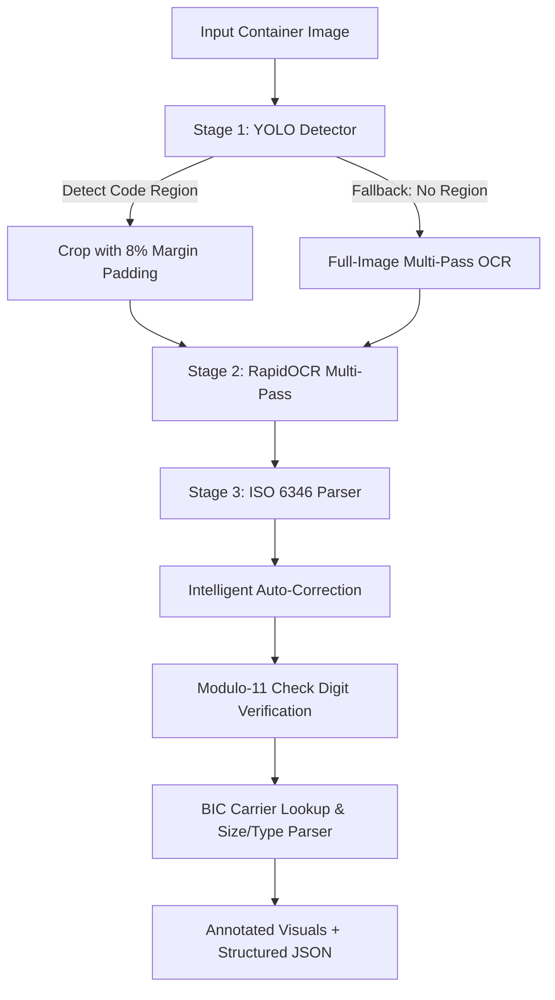

# 🚢 ContainerLens: Automated Shipping Container Number Identification System

**ContainerLens** is an end-to-end Computer Vision and OCR system engineered to detect, extract, parse, and mathematically validate international shipping container numbers (**ISO 6346**) from real-world photos, port gate cameras, and logistics imagery.

---

## 🌟 Highlights

- **Custom-Trained YOLO Detector**: Fine-tuned on the Roboflow `container-t4xvw-suyj8` dataset (6,289 images) to localize container code panels (`con-region`), filtering out ground noise, truck numbers, license plates, and yard signs.
- **Multi-Pass OCR Engine**: RapidOCR (ONNX Runtime) with adaptive CLAHE contrast enhancement and resolution upscaling to handle corrugated steel panels, rust, scratches, and shadows.
- **ISO 6346 Mathematical Validator**: Real-time verification of the Modulo-11 check digit algorithm.
- **Intelligent Error Correction**: Auto-repairs single-character OCR confusions (e.g., `0` vs `O` vs `U`, `B` vs `8`, `I` vs `1`) by testing substitutions against the ISO check digit formula and known BIC owner codes.
- **BIC Shipping Line Database**: Identifies carrier names (Triton, Maersk, MSC, CMA CGM, Evergreen, COSCO, ONE, Hapag-Lloyd, etc.).
- **ISO Size/Type Code Parser**: Identifies container length, height, and type (e.g., `45G1` = 40ft High Cube General Purpose, `22R1` = 20ft Reefer).
- **Multiple Interfaces**:
  1. 🖥️ **Streamlit Web Application** (`app.py`)
  2. 💻 **Command Line Tool** (`cli.py`)
  3. 🚀 **REST API Server** (`api.py`)

---

## 🏛️ System Architecture



---

## 🚀 Quick Start

### 1. Launch the Interactive Web Application

Double-click `start_app.bat` or run:
```powershell
python -m streamlit run app.py
```
Open your browser at `http://localhost:8501`.

**Features in Web App:**
- **Single Identifier**: Drag-and-drop any photo, pick from test dataset samples, or snap a photo using your webcam.
- **Batch Dataset Benchmark**: Benchmark recognition accuracy across 20-100 images with downloadable CSV reports.
- **Model Studio**: View dataset statistics and launch fine-tuning jobs.
- **ISO 6346 Calculator**: Inspect step-by-step modulus 11 math for any container code.

---

### 2. Command Line Tool (`cli.py`)

#### Predict on a single image:
```powershell
python cli.py predict --image test/images/1114039705751937665_0060_jpg.rf.dd3301958b55de4c06163d412bce4e26.jpg --output result.json --save-image output.jpg
```

#### Run batch benchmark:
```powershell
python cli.py batch --dir test/images --limit 25 --output results.csv
```

#### Validate container code math:
```powershell
python cli.py validate --code TCLU4897918
```

#### Fine-tune model on dataset:
```powershell
python cli.py train --epochs 5 --fraction 0.08 --batch 16
```

---

### 3. REST API Server (`api.py`)

Double-click `start_api.bat` or run:
```powershell
python -m uvicorn api:app --host 0.0.0.0 --port 8000 --reload
```
Interactive Swagger API documentation will be available at:
👉 `http://localhost:8000/docs`

**Endpoints:**
- `GET /health`: Health status and loaded model info.
- `POST /api/v1/predict`: Multipart form image upload returning structured JSON.
- `POST /api/v1/validate`: Validates code against ISO 6346 with detailed calculation breakdown.
- `GET /api/v1/sample`: Retrieves random sample image path from test dataset.

---

## 📁 Repository Structure

```
ContainerRecog/
├── app.py                   # Streamlit Interactive Web Application
├── cli.py                   # Command-line Interface tool
├── api.py                   # FastAPI REST server
├── pipeline.py              # End-to-end ContainerRecognitionPipeline
├── container_parser.py      # ISO 6346 Validator, Modulo-11 Math, Carrier Database
├── ocr_engine.py            # RapidOCR wrapper with CLAHE & upscaling
├── start_app.bat            # 1-Click launcher for Web App
├── start_api.bat            # 1-Click launcher for REST API
├── requirements.txt         # Python package dependencies
├── data.yaml                # Roboflow dataset configuration
├── weights/
│   └── container_detector.pt# Fine-tuned YOLO11n weights (con-region)
├── test/                    # 786 test images & labels
├── train/                   # 4,501 train images & labels
└── valid/                   # 1,002 validation images & labels
```

---

## 📐 ISO 6346 Verification Standard

A standardized ISO container number has 11 characters:
$$\text{Container Number} = \underbrace{\text{A B C}}_{\text{Owner}} \ \underbrace{\text{U}}_{\text{Category}} \ \underbrace{1 \ 2 \ 3 \ 4 \ 5 \ 6}_{\text{Serial Number}} \ \underbrace{[7]}_{\text{Check Digit}}$$

1. **Owner Code**: 3 uppercase letters registered with the BIC (Bureau International des Containers).
2. **Category Identifier**:
   - `U`: All freight containers (99.5%+ of industry)
   - `J`: Detachable freight container equipment
   - `Z`: Trailers and chassis
3. **Serial Number**: 6 numeric digits.
4. **Check Digit**: Modulo-11 formula:
   $$\text{Sum} = \sum_{i=0}^{9} \text{char\_val}_i \times 2^i$$
   $$\text{Check Digit} = (\text{Sum} \pmod{11}) \pmod{10}$$
