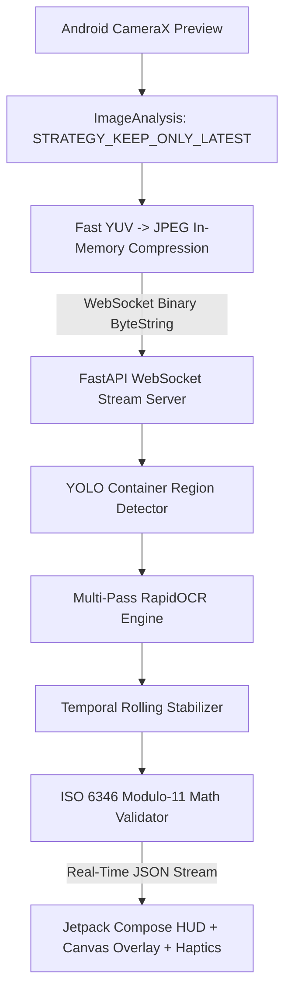

# 🚢 ContainerLens: Automated Shipping Container Number Identification System

**ContainerLens** is an end-to-end Computer Vision and OCR system engineered to detect, extract, parse, and mathematically validate international shipping container numbers (**ISO 6346**) from real-world photos, port gate cameras, and live video streams.

---

## 🌟 Highlights

- **Custom-Trained YOLO Detector**: Fine-tuned on the Roboflow `container-t4xvw-suyj8` dataset (6,289 images) to localize container code panels (`con-region`), filtering out ground noise, truck numbers, license plates, and yard signs.
- **Multi-Pass OCR Engine**: RapidOCR (ONNX Runtime) with adaptive CLAHE contrast enhancement and resolution upscaling to handle corrugated steel panels, rust, scratches, and shadows.
- **ISO 6346 Mathematical Validator**: Real-time verification of the Modulo-11 check digit algorithm.
- **Intelligent Error Correction**: Auto-repairs single-character OCR confusions (e.g., `0` vs `O` vs `U`, `B` vs `8`, `I` vs `1`) by testing substitutions against the ISO check digit formula and known BIC owner codes.
- **BIC Shipping Line Database**: Identifies carrier names (Triton, Maersk, MSC, CMA CGM, Evergreen, COSCO, ONE, Hapag-Lloyd, etc.).
- **ISO Size/Type Code Parser**: Identifies container length, height, and type (e.g., `45G1` = 40ft High Cube General Purpose, `22R1` = 20ft Reefer).
- **Multiple Interfaces**:
  1. 🤖 **Native Android App** (`android-app` - Optimized for real-time CameraX streaming input via WebSockets)
  2. 📱 **Mobile Web Scanner** (`/camera` - Zero-install browser camera with audio beep & haptics)
  3. 🖥️ **Streamlit Web Application** (`app.py`)
  4. 💻 **Command Line Tool** (`cli.py`)
  5. 🚀 **REST API & Streaming Server** (`api.py` / `streaming_server.py`)

---

## 🤖 Native Android App (Optimized for Streaming Input)

A native Android application written in **Kotlin + Jetpack Compose + CameraX** specifically engineered for continuous, real-time video streaming input.

### ⚡ Streaming Input Optimizations:
1. **CameraX `ImageAnalysis` Pipeline**:
   - `STRATEGY_KEEP_ONLY_LATEST`: Non-blocking frame queue. If the backend is processing a frame, incoming frames are dropped so the stream never lags behind real-time.
   - Stream resolution: $1280 \times 720$, converted directly in memory from YUV_420_888 to compressed JPEG (~35 KB).
   - Throttling: Regulates transmission to ~8-10 FPS for optimal battery and low network consumption.
2. **Persistent WebSocket Channel (`ws://.../api/v1/stream`)**:
   - Bypasses HTTP connection handshake overhead by streaming raw binary frame payloads over a single persistent WebSocket.
   - Sub-50ms round-trip latency.
3. **Temporal Stabilization Engine (`streaming_engine.py`)**:
   - Aggregates recognized candidates across consecutive frames to eliminate single-frame camera jitter, glare, or motion blur.
   - Automatically switches state from `SEARCHING` $\rightarrow$ `TRACKING` $\rightarrow$ `LOCKED`.
4. **Dynamic Canvas Overlay**:
   - Real-time bounding box scaled from camera coordinates to the phone screen.
   - Turns **Green** with subtle haptic vibration the instant an ISO 6346 code is verified!

### 📲 How to Install & Run the Android App:

1. **Start the streaming backend server**:
   Double-click [**`start_streaming_server.bat`**](file:///d:/_Personal/ContainerRecog/start_streaming_server.bat) (or run `python streaming_server.py`).

2. **Install APK to your Android device**:
   Plug your phone into your PC (USB Debugging enabled) and run:
   ```powershell
   .\install_to_phone.bat
   ```
   *(Or manually install [**`ContainerLens-v1.0.apk`**](file:///d:/_Personal/ContainerRecog/ContainerLens-v1.0.apk)).*

3. **Open ContainerLens on your phone**:
   Point your camera at any shipping container. The app will stream frames, lock onto the container panel in real time, and display carrier, type, and verification status!

---

## 📱 Mobile Web Scanner (Zero Install Option)

If you prefer not to install an APK, you can open the browser scanner:
1. Double-click `start_phone_scanner.bat`.
2. On your phone's browser, open `http://<PC_LAN_IP>:8000/camera` (or use `start_phone_tunnel.bat` for Cloudflare HTTPS).

---

## 🏛️ System Architecture



---

## 📁 Repository Structure

```
ContainerRecog/
├── android-app/             # Native Jetpack Compose Android Application
│   ├── app/src/main/java/
│   │   └── com/containerlens/app/
│   │       ├── data/stream/ ContainerStreamClient.kt (WebSocket frame client)
│   │       ├── ui/camera/   StreamingCameraView.kt   (CameraX analyzer)
│   │       ├── ui/overlay/  LiveBoundingBoxOverlay.kt(Dynamic canvas overlay)
│   │       ├── ui/hud/      LiveStreamHUD.kt         (Live floating result card)
│   │       └── MainActivity.kt
│   └── build.gradle.kts
├── ContainerLens-v1.0.apk   # Pre-compiled standalone Android APK
├── streaming_server.py      # Ultra-low latency WebSocket streaming backend
├── streaming_engine.py      # Real-time multi-frame temporal stabilizer
├── start_streaming_server.bat# 1-Click launcher for WebSocket streaming server
├── install_to_phone.bat     # 1-Click ADB installer for Android phone
├── start_phone_scanner.bat  # 1-Click launcher for Mobile Browser Scanner
├── start_phone_tunnel.bat   # 1-Click Cloudflare HTTPS tunnel for Phone Camera
├── app.py                   # Streamlit Interactive Web Application
├── cli.py                   # Command-line Interface tool
├── api.py                   # FastAPI REST server & Mobile Scanner
├── pipeline.py              # End-to-end ContainerRecognitionPipeline
├── container_parser.py      # ISO 6346 Validator, Modulo-11 Math, Carrier Database
├── ocr_engine.py            # RapidOCR wrapper with CLAHE & upscaling
├── weights/
│   └── container_detector.pt# Fine-tuned YOLO11n weights (con-region)
├── test/                    # 786 test images & labels
├── train/                   # 4,501 train images & labels
└── valid/                   # 1,002 validation images & labels
```
